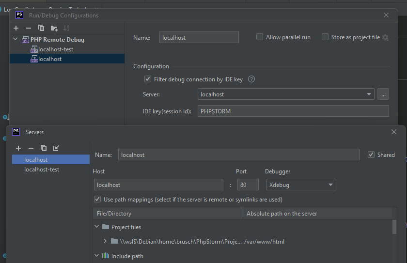

# Pimcore PHP Docker Image

This is are customized PHP Docker images specifically optimized for running [Pimcore](https://github.com/pimcore/pimcore).
It doesn't include the Pimcore software itself, it just provides an environment that fulfills all system requirements
of Pimcore, so that you can leverage the full functionality.

You can either use this image directly by mounting Pimcore into the container, or as a template for your customized 
ready-to-deploy images.   

## Usage  
As a starting point please see [example docker-compose configuration](https://github.com/pimcore/skeleton/blob/HEAD/docker-compose.yaml).

## Image flavors
We're providing different image flavors: 
- [`min`] PHP image for FPM and CLI with minimum requirements (e.g. `php8.2-min-latest`)
- [`default`] PHP image for FPM and CLI incl. all optional dependencies (e.g. `php8.2-latest` or `php8.2-default-latest`)
- [`max`] PHP image for FPM and CLI incl. all optional dependencies and additional extensions and software (e.g. `php8.2-max-latest`)
- [`debug`] PHP debug image based on the `default` flavor, including preconfigured Xdebug for FPM and CLI (e.g.  `php8.2-debug-latest`)
- [`supervisord`] Supervisord image based on PHP image above, for cron & queue processing  (e.g. `php8.2-supervisord-latest`)

## Versioning
Our images are versioned using a version-suffix staring with `-v` following SemVer (e.g. `-v2.0`).   
With that we're able to allow smooth upgrades, breaking changes are only delivered with major versions.  
Additionally we're offering 2 special tag suffixes: 
- `-latest` always points to the latest available tag (recommended for local development)
- `-dev` always points to the work in progress

We're also offering special tags for specific PHP versions, e.g. `php8.2.5-v2.0`. 

## Hardened images

> **Status (2026-10-28): publishing of `-hardened` tags is paused.** The last `-hardened` tags were
> pushed on 2026-07-31 and are not refreshed. Use the plain tags; they are the supported images and
> are rebuilt on every scheduled run with all Debian security updates available at build time.
> Hardened publishing resumes once there is a strategy that delivers it consistently.
> The description below documents what the `-hardened` flavor is when it is enabled.

For our stable release tags the release workflow can publish each image in two flavors so you can choose your trade-off:

- **plain** (default, unsuffixed) – the image exactly as built from the Dockerfile, e.g. `php8.5-debug-v5`. Published as-is; it may carry known OS-level CVEs.
- **hardened** (`-hardened` suffix) – the same image with OS-level CVEs patched in via [Copacetic (Copa)](https://github.com/project-copacetic/copacetic), e.g. `php8.5-debug-v5-hardened`.

**What hardening does:** after the plain image is built it is scanned with [Trivy](https://github.com/aquasecurity/trivy) and Copa applies the Debian security updates that are *available* for the affected OS packages, as an extra image layer. PHP, its extensions, and all application-level content are identical to the plain image — only OS package versions differ.

**What the gate does (and does not) guarantee:** the `-hardened` tag is published only when, after patching, no **fixable** CVE at or above the `fail_on_severity` threshold remains — i.e. Copa applied every fix that was available. `fail_on_severity` is a **threshold** (default `CRITICAL,HIGH`): naming a severity also gates everything above it (e.g. `HIGH` gates HIGH and CRITICAL), and `NONE` disables the gate. The gate does **not** shield against CVEs that have **no upstream fix yet** — those are excluded from the scan and remain in *both* the plain and hardened images until Debian ships a fix. So `-hardened` means "all currently-fixable OS CVEs at the threshold are patched", not "zero known CVEs".

**Scope:** `-hardened` exists for **stable release tags only**; development tags (`-dev`) are plain-only. The plain tag **always publishes**, even when CVEs remain.

> **Testing the hardened path without publishing:** trigger the release workflow via
> **workflow_dispatch** with `publish: false`. The stable images are built, Copa-patched,
> scanned, and gated entirely on the runner (using the containerd image store) — **nothing
> is pushed** to Docker Hub or GHCR. Use `publish: true` with `publish_hardened: false` to
> publish the plain tags while still building and gating the hardened images locally.

**Choosing a flavor:** prefer **hardened** for production or vulnerability-scanned environments where you want the latest available OS fixes baked in; use **plain** when you need the image exactly as built (reproducibility, or you run your own patching/scanning pipeline).

```text
php8.5-debug-v5          # plain image, as built (may contain CVEs)
php8.5-debug-v5-hardened # same image, all available OS CVE fixes applied
```

**SBOMs:** every published image (plain and hardened, per architecture) ships an SPDX SBOM. It is always uploaded as a build artifact, and — where the registry supports OCI referrers — attached to the published image so it is discoverable with `oras discover` on the tag you pull (the multi-arch tag carries a referrer per architecture).

Retrieving the SBOM with [`oras`](https://oras.land/):

```text
# Discover the SBOM referrer(s) on the tag you pull (one per architecture).
# Note the docker.io/ prefix for Docker Hub — oras (unlike docker) does not
# apply that default, so a bare "pimcore/pimcore:..." ref will not resolve.
oras discover --artifact-type application/spdx+json ghcr.io/pimcore/pimcore:php8.5-v5.2
oras discover --artifact-type application/spdx+json docker.io/pimcore/pimcore:php8.5-v5.2

# Pull the SBOM blob using a referrer digest from the discover output above.
oras pull ghcr.io/pimcore/pimcore@<referrer-digest> -o ./sbom
```

Attaching is best-effort (it's skipped if the registry rejects OCI referrers), so if `oras discover` comes up empty, fall back to the guaranteed copy: download the `sboms_*` artifact from the corresponding release workflow run.

### Experimental: `-hardened-test` (Docker Hardened Images pilot)

`pimcore/pimcore:php8.5-min-v5-hardened-test` is an **experimental, unsupported** image built from
[Docker Hardened Images](https://docs.docker.com/dhi/) (`dhi.io/php`, Apache-2.0) instead of the
official `php` image, see [`Dockerfile.dhi`](Dockerfile.dhi). It exists to measure whether a hardened
base image is a better path than Copa. It may change or disappear without notice.

- **`min` flavor only, PHP 8.5, Debian 13, amd64 only.** No `default`, `max`, `debug` or `supervisord`
  flavor: DHI does not provide ghostscript, ImageMagick, ffmpeg, poppler, LibreOffice or Chromium, so
  those tools would come unpatched from plain Debian and a distroless runtime cannot install them.
- **Distroless runtime:** no shell, no package manager, runs as uid/gid `65532` (`nonroot`), not root.
  Mounted volumes must be writable by that user. Use `docker debug` for troubleshooting.
- PHP lives under `/opt/php-8.5`; `/usr/local/etc/php` is a symlink to its ini directory, so
  `conf.d` overrides work as with the regular images.
- Same extensions as `min` (`amqp bcmath exif gd intl pcntl pdo_mysql sockets zip`), same
  `php.ini`/`php-fpm` environment variables, `php` CLI and `composer` included.
- **Runtime image only.** Without `/bin/sh`, anything that spawns a process fails: `composer
  create-project`/`install` (composer shells out for `rm -rf`, `git`, `unzip`), composer scripts and
  Pimcore commands that call external tools. Build the application with the regular image or a
  `-dev` stage and copy it in.
- Built, tested and scanned by `hardened-test.yml` on pull requests that touch it and on manual dispatch;
  published only on a manual dispatch with `publish=true`. It is not part of the release matrix, has no
  `-latest`/ghcr tags and no attached SBOM.

## Known CVEs

For every **published stable release image** we publish a CVE and hardening report,
regenerated on each publish: [`docs/known-cves.md`](docs/known-cves.md). 
It has a dedicated [Docker report page](https://pimcore.github.io/docker/)
It opens with the
hardening outcome, per-severity totals, a per-variant breakdown (variants differ by more
than an order of magnitude), the worst-affected packages, and a per-image table of severity
counts and digests. Critical and high severity CVEs are listed in full there; the remaining
severities are split into [`docs/known-cves-medium.md`](docs/known-cves-medium.md) and
[`docs/known-cves-low.md`](docs/known-cves-low.md) so every file stays within GitHub's
rendering limit.

Kernel-header (`linux-libc-dev`) CVEs are excluded from the tables — a container runs on the
host kernel, so they are not reachable inside these images — and the summary states how many
were excluded. The complete machine-readable data, including those rows, is the
`cve-report-json` artifact on the corresponding release workflow run.

Development / rolling (`-dev`) tags are plain-only and are not covered.

## Container registries
Our images are available on both Docker Hub and the GitHub Container Registry, so you can choose the one that best fits your workflow.
Use either of the following commands:
`docker pull ghcr.io/pimcore/pimcore:php8.3-debug-v3-dev` or 
`docker pull pimcore/pimcore:php8.3-debug-v3-dev`


### Pimcore version compatibility & recommendations
| Image / Pimcore | v10 | v11 | v2023.3 | v2024.4 | v2025.x | v2026.x |
|-----------------|-----|-----|---------|---------|------|-------|
| v1              | ✅  | ✅  | ✅      | ✅      | ❌   | ❌    |
| v2              | ❌  | ✅  | ✅      | ✅      | ❌   | ❌    | 
| v3              | ❌  | ✅* | ✅*     | ✅*     | ✅   | ❌    |
| v4              | ❌  | ❌  | ❌      | ❌      | ✅*  | ❌    |
| v5              | ❌  | ❌  | ❌      | ❌      | ❌   | ✅*   |


### Pimcore image versions support
| Image | Supported |
|-------|-----------|
| v1    | ❌        |
| v2    | ❌        |
| v3    | ✅        |
| v4    | ✅        |
| v5    | ✅        |

We are basing our images on top of the official PHP and Debian images and providing support until EOL for the [PHP versions](https://www.php.net/supported-versions.php) and [Debian versions](https://wiki.debian.org/LTS)

## Examples 

### PHP images
```text
php8.2-latest # always use the latest PHP 8.2 image
php8.3-v3 # always point to the latest minor version of v3
php8.3-v3.8 # pin to specific image version, always using the latest bugfixes from PHP 8.3
php8.3.5-v3.8 # pin to a specific PHP version & image version 
php8.2-dev # development image (build from the default branch) 
```

### PHP Debug images
Same as PHP images, but using `-debug` after the PHP version:
```text
php8.2-debug-latest
php8.2-debug-v3
...
```

#### Configure Xdebug in your IDE

The following configuration depends on the default [`docker-compose.yaml`](https://github.com/pimcore/skeleton/blob/11.x/docker-compose.yaml). 



#### Use step-debugging

- **Browser**: Install "Xdebug helper" browser extension for [Chrome](https://chrome.google.com/webstore/detail/xdebug-helper/eadndfjplgieldjbigjakmdgkmoaaaoc) or [Firefox](https://addons.mozilla.org/en-GB/firefox/addon/xdebug-helper-for-firefox/) and start debugging session in your tab. 
- **CLI**: Run your command like this: `docker compose exec -e XDEBUG_TRIGGER=PHPSTORM php bin/console`

### Supervisord
Same as PHP images, but using `-supervisor` after the PHP version:
```text
php8.2-supervisor-latest
php8.2-supervisor-v3
...
```
